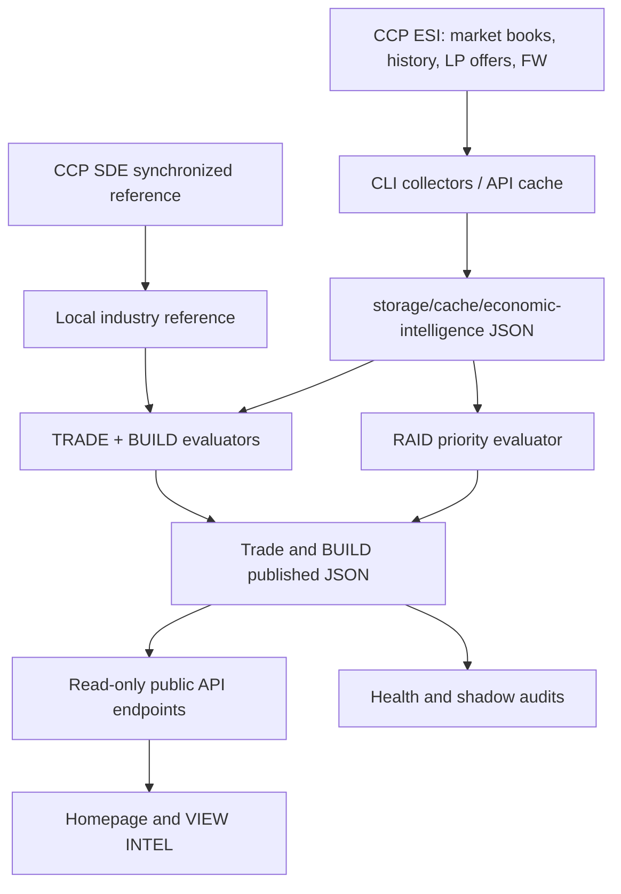

# Guristas.net — Intelligence Architecture and Decision Pipeline

**Source revision:** `4a5f05ea34ba2d8f61651744087b3b4fea876fe8` (`main`, collected 2026-10-13 17:40 CDT)  
**Scope:** RAID, TRADE, BUILD collection, reference data, selection, publishing, and homepage consumption.  
**Status:** Source-grounded documentation, not an assertion that current production schedules, cache contents, or configuration exactly match the repository.

> **How to use this document:** Read §§1–3 for the system and chronological order; §§4–6 for actual selection logic; §7 for efficient collection and freshness; §8 for production operations; §§9–10 for auditing and gaps. Source file paths in backticks refer to the repository root. Line locations may shift after edits.

## 1. System map



**Boundaries:** Network collection is designed for CLI/scheduled workers; normal page requests read published JSON. RAID is refreshed by its own command; TRADE and BUILD have separate publishers. The repository collection **omits** live `config/` secrets, cron state and runtime storage: this document cannot verify their current production settings.

## 2. Intelligence sources and provenance

| Input | Acquisition / canonical implementation | What it does and does **not** establish |
|---|---|---|
| Public CCP ESI regional market orders | `app/services/EsiClient.php`, `MarketPageClient.php`, `MarketIntelligence.php::collectRegion` | Asks, bids, quantity, min volume, order IDs, stations; snapshots are observations, not guarantees of fulfillment. |
| CCP ESI market history | `MarketIntelligence.php::marketHistory`; `TradeOrders.php::historyEvidence` | Regional price/volume history, **not** station-level sales or proof an order will fill. Failed lookups are negatively cached. |
| Commando Guri LP offers | `PublicIndustry.php`, `MarketIntelligence.php::refreshOffers` | Exchange costs, quantities and requirements; economic valuation still depends on other sources. |
| Faction-war / insurgency | `DataServices.php`, `FrontlinesService.php`, `MarketIntelligence.php::refreshRaid` | Campaign and system stages for a deterministic tactical priority; does not predict the winner. |
| Static industry catalog / SDE | `bin/guristas-sde-sync.py`, `bin/guristas-build-catalog.py`, `app/data/industry-reference.json` | Recipes, PI schematics, reprocessing, items; recipes alone do not establish skills, profitability or physical resources. |
| Venal planet types | `bin/guristas-build-planets.php`, published `build-venal-planets` | Public inventory of planets and types. **Not** PI extraction yield, resource density or colony access. |
| Internal observational history | `RaidPriority.php` / `MarketIntelligence.php::raidHistoryAppend`, `TradeAudit.php`, `BuildAudit.php` | Audit/trends. RAID historical samples explicitly do **not** affect the live RAID target. |
| Fulcrum facility assumptions | `BuildIntelligence.php::fulcrumShipBenefits` | Eligibility-based 6% facility ME / 70% TE and potential SCC surcharge reduction; actual job quote/skill/facility verification required. |

### Market geography and constraints

Core collected regions used by BUILD: Jita / The Forge `10000002`, Venal `10000015`, Zarzakh / The Fulcrum `10001000`. Jita station `60003760` is explicitly used for relevant acquisition/bid benchmarks. TRADE considers further external regional rotation. **Do not infer zero economic value from sparse Fulcrum/Venal orders.** Outside-hub quotes provide benchmarks; a profitable local listing still needs independent demand/turnover evidence.

## 3. Chronological order: what happens first

1. **Reference preparation / daily synchronization.** `guristas-sde-sync.py` refreshes static industry references; catalog/planet importers fill local reference and planet inventories. SDE synchronization is a separate lifecycle from market collection.
2. **Acquire priority markets.** `php bin/guristas-intelligence.php priority` or `trade-cycle` requests Zarzakh (`10001000`) and Venal (`10000015`), storing complete normalized snapshots. `region <id>` collects a named region.
3. **Collect LP offers.** `offers` or `trade-cycle` refreshes the Commando Guri LP store. On several publish/collection commands, if LP snapshot is absent or ≥24 hours old, the CLI attempts a refresh and rejects expired LP data on failure. **BUILD itself uses a different ≤48-hour offer check**; reconcile deliberately.
4. **Rotate external regions.** `rotate` / `trade-cycle` alternate stale priority trade-hub selection and broader discovery using a persisted cursor. Among external hub candidates older than 1 hour, select the stalest. Other scans follow background rotation. Scan order matters because external relevant item types are derived in part from priority-region orders and LP offers.
5. **Normalize/validate market pages.** `MarketIntelligence::collectRegion` validates completeness, consistent page counts, timestamps (market pages must be ≤15 minutes old), region IDs, positive prices/volumes, NPC station IDs, and stores atomically. Priority-region scans retain all qualifying NPC-station orders; external regions retain **at most 24 competitive quotes per item and order side**, selected by highest bids / lowest asks.
6. **Refresh observational market history where requested.** `marketHistory` caches verified regional day rows for ~24 hours and negative-caches unavailable history; historical evidence feeds selected TRADE checks, not a universal hard profitability guarantee.
7. **Compute RAID independently.** `php bin/guristas-intelligence.php raid` collects campaign data, attaches `RaidPriority::recommend`, records bounded observational trends, and publishes `raid`.
8. **Compute TRADE.** Commands including `publish`, `trade-cycle`, `priority`, `region`, `rotate`, and `offers` build `GuristasTradeOrders::collect`, decorate station/item labels, publish `trade-orders`, and optionally record a shadow audit.
9. **Compute BUILD separately.** `php bin/guristas-build.php publish` loads market snapshots and LP offers, computes `GuristasBuildIntelligence::collect`, publishes `build-orders`, records `BuildAudit`; it does not automatically run after every TRADE publish.
10. **Serve published data.** `public/api/war/raid-orders.php` (≤900 seconds, `stale` marker after 300); `public/api/industry/trade-orders.php` (≤1800 seconds, `stale` after 900); `public/api/industry/build-orders.php` (≤1800 seconds). Expired/unavailable publications return HTTP 503; they do **not** silently manufacture live recommendations.
11. **Render.** `public/assets/js/home-command.js` and `public/index.php` display a concise action/price summary and disclosure; industry page uses `public/assets/js/public-industry.js` and corresponding APIs. Display is not the origin of the ranking.
12. **Repeat on configured schedules.** The repository contains cron installers and Venal collector systemd units, but an actual schedule audit must read `sudo crontab -u apache -l` and `systemctl list-timers --all`; do not equate installer scripts with verified active jobs.

## 4. RAID selection — exact decision hierarchy

Implementation: `app/services/RaidPriority.php`; publication: `MarketIntelligence.php::refreshRaid`.

**Hard gates:** Exactly one campaign must be `ACTIVE` and not ended. Candidate systems need an integer corruption stage from 0 through 4, and cannot have integer suppression stage 5. Otherwise recommend `HOLD POSITION`.

**Score:** `100 × corruption_stage + clamp(corruption_percent, 0..100)`, plus conditional bonuses:

| Condition | Added points |
|---|---:|
| Suppression ahead of corruption, suppression under 5 | +40 |
| Contested and suppression stage 4 | +20 |
| Contested, corruption ≥2 and suppression minus corruption ≤1 | +15 |
| Suppression 4 and corruption 4 | +25 |
| Corruption 4, ≥80% complete | +100 |

**Tie-break order:** (1) descending total score, (2) fewer graph edges to an insurgency system adjacent to high-sec, (3) system name alphabetical. Distance is graph-hop proximity, **not** measured flight time or travel risk. `raidHistoryAppend` retains a seven-day bounded observational history with ≥30 minutes between samples and maximum 400 samples; its records **do not modify** the current ranking. These weights are designed heuristics, not outcome-validated win probabilities.

## 5. TRADE selection — candidate economics and strict slots

Implementation: `app/services/TradeOrders.php`; market source: `MarketIntelligence.php`; historical caveats: `TradeAudit.php`.

**In order:**

1. Read fresh market/LP/reference data; normalize station-limited asks/bids and min quantities; prepare market history where available.
2. Generate acquisition options and candidate types (direct ask-to-bid trades, new buy/sell orders, LP redemption / LP-based builds as supported). Restrict markets and goals according to source/destination and pirate-economy eligibility.
3. Determine quantity supported by available sellers and destination order depth. Evaluate costs, modeled sales tax (base 7.5%), broker fee (3% assumption on listing), opportunity costs and LP shadow valuation (`1,000 ISK/LP`). Distinguish **confirmed bid** from speculative listing and conditional evidence.
4. Score positive candidates: modeled net return × capital efficiency × depth factor, with multiplier `0.65` on conditional candidates and `0.42` on listing candidates. These are ranking units; **score differences are not ISK profit differences**. See `candidate` for current exact implementation.
5. Independently produce an **audit portfolio** with distinct items, at most one LP candidate, five strategic requirements (`FULCRUM`, `VENAL`, `GURISTAS_LP`, `NEW_ORDER`, `IMMEDIATE_TRADE`) and at most a 5% economic-score concession to the unrestricted reference. **This is not the actual homepage selection rule**; `Five strategic goals met: NO` must not be mistaken for a failed public API.
6. **Homepage strict selection:** allocate candidates to `GURISTAS_LP`, `IMMEDIATE`, `NEW_ORDER`. LP role sorted primarily by modeled proceeds per LP (not arbitrary lot profit). Others sort by candidate score. Each list is capped at 48 after type controls (up to four per type). Reserve selected slots in order **GURISTAS_LP → IMMEDIATE → NEW_ORDER** to prevent the earlier slot from consuming the LP product; display them in order **IMMEDIATE → NEW_ORDER → GURISTAS_LP**. Never repeat an item across homepage cards. If a slot cannot qualify, show honest standby output rather than fake profitability.
7. Decorate names and locations at publication time. Missing verified names/locations or extreme ROI (>10×) is flagged `conditional` with execution warnings. Historical liquidity is evidence, not a guarantee.

**Critical semantics:** The published role set does not automatically meet all five strategic goals; portfolio score tolerance is diagnostic. A visible buy order still has depth, minimum-volume, movement and competition risks. Market history is regional.

## 6. BUILD selection — exactly three independent slots

Implementation: `app/services/BuildIntelligence.php`; three card order: manufacture, mine, PI. `collect()` reads only Jita/The Forge, Venal and Zarzakh/The Fulcrum market snapshots deemed complete and ≤10,800 seconds old, plus LP offers ≤172,800 seconds old. Market lead, market context, and supply objective have different confidence meanings.

### 6.1 Manufacturing

1. Build eligible blueprint recipes from LP offers + reference. The full catalog is indexed, **but economic scoring is LP-blueprint-gated**. Reference reporting counts matches/unmatched and is not proof that 4,867 recipes are evaluated for profit.
2. For each eligible blueprint, validate run/time metadata and obtain complete Jita 4-4 ask fills for every material.
3. Independently compute eligible Fulcrum material-efficiency scenario at 6% ME and other facility benefit evidence; **the winner's ranking uses baseline material costs**, not fully realized Fulcrum job net profit.
4. Find station-supported destination bids for the produced quantity in Venal, The Fulcrum or Jita 4-4, satisfying order depth and minimum volume.
5. Compute modeled pre-job margin: `0.925 × quoted_output_revenue − baseline_Jita_materials − (LP_cost × 1000 + LP_ISK_cost)`; reject margins below 2,000,000 ISK; choose maximum margin (not ISK/hour or ROI).
6. Benchmark the cost of acquiring a completed product at Jita asks against blueprint + material cost; show details and actual bid/station identifiers; **job fees, actual taxes, shipping, hauling, run duration and live job quote are not fully priced into winner ranking**.
7. Fallback to evidence-qualified Worm supply objective if no qualifying deal.

### 6.2 Mining

1. Compare the explicitly supported resource/ore/ice references, buyer quotes and reference-lot depth; use reprocessing references where available.
2. Rank by modeled gross value per m³ / depth-adjusted evidence in `resourceLeads()` and `mineralLead()`, then display an instruction framed around supplying The Fulcrum.
3. **Major feasibility limitation:** the code explicitly records `live_deposit_verified=false`; the winning recommendation does not prove the ore is mineable in Venal. Gross ISK/m³ is **not net ISK/hour**, and posted market demand is not physical resource availability.

### 6.3 Planetary industry (v42)

1. Evaluate imported SDE PI schematics having valid input list, output quantity, and positive cycle time.
2. Price **all** schematic inputs using sufficient posted Jita 4-4 asks. Reject a recipe if any input cannot be fully quoted.
3. Search sufficient single-station output buyer orders in **The Fulcrum → Venal → Jita** (that is iteration order, not a promise of local preference over better economics). Require buyer depth at least one cycle's output quantity and compatible minimum volume.
4. Compute `pre-PI-cost margin per cycle = 0.925 × (output_qty × buyer_price) − input_ask_cost`; require positive margin and valid time.
5. Compute `modeled margin per factory-hour = margin_per_cycle × 3600 / cycle_seconds`; choose **maximum hourly modeled margin**. Equal ties inherit iteration order because replacement requires strictly greater score.
6. Emit evaluated/qualified/rejected candidate counts in the chosen PI card's evidence, plus buyer order, station, cycle, inputs and expected output. **These counters need not appear in the publisher's top-level coverage**.
7. If no qualified imported schematic exists, use the explicitly described Synthetic Synapses candidate/supply objective pathway. The planet-type catalog documents possible planets only; it cannot verify PI extraction yield.

**No BUILD slot presently establishes complete risk-adjusted net ISK/hour.** Where quoted net economics cannot be justified, preserve a `market_context` or `supply_objective` disclosure rather than claiming profit.

## 7. Data quality, refresh and computational efficiency

| Layer | Current source-backed safeguard | Limitation or check |
|---|---|---|
| ESI transport | HTTP metadata-based expiration, cache/stale-if-error behavior and bounded request batching in `EsiClient.php`, `EsiCache.php` | API caching does not imply all consumer snapshots are eligible when served stale. |
| Region ingest | Complete consistent page set, ≤900-second page freshness, atomic JSON publish | Old region snapshot retained when ingest fails. |
| Market retention | Full eligible NPC orders for priority regions; up to 24 best bids/asks per item/side for external regions | Intentionally incomplete external market depth; certain opportunities can be missed. |
| Market discovery | 2 priority regions plus aged hub/background rotation | No exhaustive real-time coverage; unequal regional recency. |
| LP | TRADE CLI attempts fresh offers around 24 hours; BUILD accepts up to 48 hours at `collect()` | Freshness inconsistency; document or reconcile. |
| Output API | RAID 900s max; TRADE and BUILD 1800s max; short HTTP browser cache | A successful publisher run does not prove the API will remain available without scheduling. |
| Snapshot writing | Temporary file, JSON serialization, permission setting, atomic rename | Requires writable `storage/cache/economic-intelligence` directory. |
| Concurrent workers | CLI file locks prevent overlapping collector/publisher jobs of same lock scope | RAID/TRADING locks and separate BUILD lock have different scopes. |
| Audits | Trade and BUILD shadow audit logs; RAID 7-day observations | Diagnostic only; do not claim automatic learned optimization. |
| Homepage | Reads published results instead of recomputing expensive candidates for each visitor | Public page can show last successfully published result until API expiration or browser state refresh. |

## 8. Operational playbook (read-only first)

**Inspect repository version and test files on Windows:**

```powershell
Set-Location 'K:\xampp\htdocs\guristas.net'
git rev-parse HEAD
git status --short
Get-ChildItem tests/test_build*,tests/test_intelligence*,tests/test_trade* | Select-Object Name
```

**Inspect actual active schedules on EC2; installers do not establish runtime state:**

```bash
cd /var/www/sites/guristas.net
sudo crontab -u apache -l
systemctl list-timers --all | grep -i guristas || true
```

**Read-only service health:**

```bash
php bin/guristas-intelligence-health.php
php bin/guristas-reference-coverage.php
curl -sS -o /dev/null -w 'RAID: %{http_code}\n' https://guristas.net/api/war/raid-orders.php
curl -sS -o /dev/null -w 'TRADE: %{http_code}\n' https://guristas.net/api/industry/trade-orders.php
curl -sS -o /dev/null -w 'BUILD: %{http_code}\n' https://guristas.net/api/industry/build-orders.php
```

**Regression tests (read only):**

```bash
php tests/test_raid_priority.php
php tests/test_trade_homepage_v29.php
php tests/test_build_v42.php
php tests/test_build_v41.php
php tests/test_build_v40.php
php tests/test_build_catalog_reporting_v38.php
php tests/test_build_intelligence_v26.php
node tests/test_home_intel_v39.js
node tests/test_home_build_v41.js
```

**Explicit writes — execute only when intentional:**

```bash
sudo -u apache /usr/bin/php -d memory_limit=256M bin/guristas-intelligence.php raid
sudo -u apache /usr/bin/php -d memory_limit=256M bin/guristas-intelligence.php trade-cycle
sudo -u apache /usr/bin/php -d memory_limit=256M bin/guristas-build.php publish
```

Market collection is subject to CCP availability, current permissions, caches and scheduling. Do **not** deploy with `git pull` on EC2: this project uses Windows source control and `K:\xampp\htdocs\website-deployment\deploy-guristas.bat` to transfer tracked files. Inspect the local Git diff, commit and push on `main`, ensure the working tree is clean, then use the established deployment script. Do not copy local secrets or replace runtime `storage`.

## 9. File responsibility map

| Responsibility | Primary files |
|---|---|
| CCP transport/cache | `app/services/EsiClient.php`, `EsiCache.php`, `MarketPageClient.php` |
| Collection & market history | `app/services/MarketIntelligence.php`, `bin/guristas-intelligence.php` |
| Insurgency sources/scoring | `app/services/FrontlinesService.php`, `DataServices.php`, `RaidPriority.php` |
| TRADE generation/portfolio/slots | `app/services/TradeOrders.php`, `TradeAudit.php` |
| BUILD manufacturing/mining/PI | `app/services/BuildIntelligence.php`, `BuildAudit.php` |
| Data preparation/import | `bin/guristas-sde-sync.py`, `guristas-build-catalog.py`, `guristas-build-planets.php`; `tools/build-industry-reference.py`, `tools/build-full-blueprint-db.py` |
| Reference catalog | `app/data/industry-reference.json`, `app/data/venal-systems.json` |
| CLI publication/health | `bin/guristas-build.php`, `guristas-intelligence-health.php`, `guristas-trade-audit.php`, `guristas-build-audit.php` |
| Public API read | `public/api/war/raid-orders.php`, `public/api/industry/trade-orders.php`, `public/api/industry/build-orders.php` |
| Homepage and industry UI | `public/index.php`, `public/assets/js/home-command.js`, `public/assets/css/home-command.css`, `public/industry/index.php`, `public/assets/js/public-industry.js` |
| Cron / timer templates | `bin/install-intelligence-cron.py`, `bin/install-intelligence-daily-cron.sh`, `deploy/systemd/guristas-venal-collector.{service,timer}` |
| Regression | `tests/test_raid_priority.php`, `test_trade_homepage_v29.php`, `test_build_v40.php`, `test_build_v41.php`, `test_build_v42.php`, and adjacent test suites |

## 10. Audit findings and prioritized remaining work

**Highest priority**

1. **Mining qualification:** require verified Venal resource/location eligibility before calling a result an executable `Mine` order; otherwise publish a clearly conditional reconnaissance/supply candidate. Source: `BuildIntelligence.php::resourceLeads`, `mineralLead`.
2. **Manufacturing economic universe:** actually evaluate the full SDE manufacturing catalog where acquisition is feasible, instead of restricting scored candidates to LP blueprints. Incorporate live Fulcrum job quote, actual eligibility, taxes, skills, source and transport costs. Source: `manufacturingReference`, `bestManufacture`, `fulcrumShipBenefits`.
3. **PI true cost comparison:** add customs/POCO taxes, factory costs, feasible planet/colony assumptions, haul and downtime; distinguish input import from local extraction and price execution. Source: `importedPiLead`.
4. **Buyer/liquidity realism:** preserve demand-development goals for Venal/The Fulcrum but keep reference price and guaranteed execution claims separate. History is regional; quote depth does not equal sell-through probability.

**Next**

5. **Diagnostic parity:** surface PI evaluation counts prominently in publisher/health diagnostics rather than only the selected card evidence, and explicitly report why manufacture and mine candidate alternatives lose.
6. **Freshness reconciliation:** make the 24-hour TRADE LP and 48-hour BUILD LP policies intentional and test them; verify cron cadence exceeds no API publication TTL.
7. **TRADE strategic coverage:** investigate `Five strategic goals met: NO` against its diagnostic 5% portfolio budget; do not change homepage strict roles merely to force the metric to YES.
8. **RAID validation:** replay candidate rankings against historical insurgency outcomes before introducing momentum as a priority weight.
9. **Performance telemetry:** measure API calls, ESI page count, age distributions, candidate survival by rejection reason, evaluator runtimes, and stale-publication events; avoid describing system as mathematically optimal absent measurements.

## 11. Verification checklist after future edits

- [ ] Snapshot source and refresh policy stated per subsystem; external error does not produce fabricated market facts.
- [ ] Region/order fill checks preserve station, quantity, minimum volume and bid/ask direction.
- [ ] RAID requires exactly one active insurgency; deterministic ties and hold behavior remain tested.
- [ ] TRADE homepage still has three **distinct** strict roles; diagnostic five-goal portfolio is not substituted for live selection.
- [ ] BUILD still publishes manufacture, mine, PI in that order; buyer references and fallback states remain explicit.
- [ ] Manufacturing metric clearly excludes job/haul cost unless genuinely priced.
- [ ] Mining never mistakes external bid for verified local resource deposition.
- [ ] PI formula normalizes to factory-hours without claiming net colony profit.
- [ ] Publisher reports intended three cards, healthy snapshots and proper API status; compare selected card IDs and evidence before/after deployment.
- [ ] Local Git review/commit/push and standard deployment workflow used; no secret files or unrelated changes packaged.

---

**Evidence boundary:** This document is based on the 164-file source export at the Git revision above and the production command outputs shared in the conversation. The export is selective by path and excludes live runtime storage, certain config, current cron definitions and any relevant source outside the chosen collection filters. Those omissions must be checked before calling this a complete production audit. No code behavior was altered by this documentation release.
